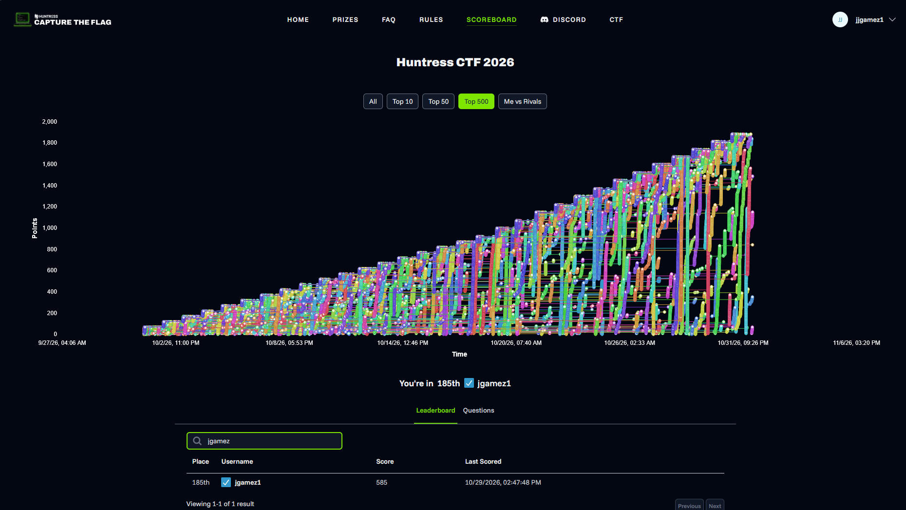

# Huntress CTF 2026

**Result: 185th of 1,602, with 585 points.** This was my first CTF.

[Completion certificate](https://ctf.huntress.com/completion/5c55a363663f050e) (at the time of writing the organizers' certificates were still generic, so it doesn't show a placement)

> **About this writeup.** I played this with AI doing most of the hands-on work, and I built an agent to run the loop. The event was designed for that. I set the strategy, reviewed the results, and made the calls when it got stuck, but most solvers were written by the AI and I didn't personally solve most of these by hand. I also worked through the stuck challenges and drafted these pages with Claude. Flags are redacted because they're unique to each team. The per-day pages are summaries of the agent's notes.

## The format

Huntress built this year's event around AI. You work in a browser VM with an AI assistant, and an AI **Game Master** hands out and grades challenges. Each day added a challenge in several categories: warmups, metadata forensics, script analysis, binary reverse engineering, Android, and later web. Most challenges have three modes:

- **Single Solve:** one artifact, no timer.
- **Time Trial:** a fresh randomized artifact and a short deadline (30–50 seconds).
- **Mastery:** several fresh artifacts at once, under a tight deadline.

Random inputs mean you can't reuse answers, and the deadlines mean you can't work by hand. So the real challenge is building tools that survive variation.

## How the agent works

After [Day 1](day-01/README.md), where I prompted my way through each challenge, I had the AI build an agent around this loop:

1. **Find** the next unfinished challenge through the Game Master's list.
2. **Understand** it: save the questions, answer formats, and artifact. Identify files by their bytes, not their names.
3. **Reuse or build** a solver: check a registry of what each solver handles, extend the closest match, and write a new one only if nothing fits.
4. **Pass Single Solve**, then run the timed modes.
5. **Record** what happened, then move on.

The safety rules mattered as much as the loop:

- **Never guess.** Every answer has to come from the artifact, and solvers never run the artifact. At most 3 submissions per mode, each resubmission needs a written diagnosis, and if two answers are plausible, it asks.
- **Approve the code, not the answer.** Approving each timed submission didn't work, because a person can't read and reply inside 30 seconds. So a solver's code is hashed. Any change triggers an offline review against all saved attempts, and the timed modes only run under an approved hash. The approval happens before the clock starts.
- **Hand back when blocked.** Missing setup, needing to run a file, or an unclear answer gets a written handoff, and the run moves on to the next challenge.
- **Keep flags out of everything.** They go in one private file, never in logs or notes.

I built it in stages with a checkpoint after each one, from a shared client up to a fresh-session test where a new chat had nothing but the skill to go on. Supervised runs came first, and the agent only went autonomous once those looked right.

The build brief I gave the AI is in [`agent-prompt.md`](agent-prompt.md). The code is in [`agent/`](agent/), and the reusable skill is in [`skill/`](skill/). It's a snapshot from October 28, so the last run's additions (the Brainfuck/Ook! decoder and per-field routing) aren't in it. It won't run as-is: it depends on the event's Game Master, and I left out the live web-target collector and its solver because they were only useful against the event's own targets.

## What I learned

### All-or-nothing grading

The biggest obstacle: **a submission is simply correct or incorrect, with no hint about which field was wrong**, and some challenges have hundreds of fields. On top of that, later challenges in a category include the question families from every earlier day. So one unsolved family poisons every later challenge that includes it. That's why the script analysis category stalled after Day 2 (everything from Day 3 on includes Batch), and why the big Day 27 and 28 binary challenges failed.

What helped:

- **Field-by-field review tables.** Lining up each question, its stated format, every submitted answer, and the evidence found the [Mangled](day-02/README.md#mangled) bug that three automated submissions missed.
- **Single-field challenges.** With one field, a wrong answer can only be that field. That's how [Where Do We Begin?](day-10/README.md#where-do-we-begin) proved hex values need zero-padding.
- **Comparing challenges.** [Thirty-Two Below](day-10/README.md#thirty-two-below) and [Eighty-Five Alive](day-23/README.md#eighty-five-alive) only made sense side by side.

### Check a theory before spending a submission

Plenty of theories turned out wrong: about relay roles, Batch control flow, next-stage values, wrong files, sort order, and hex padding on one field. Most died to a cheap check of the raw bytes. That habit mattered more than being right.

### Rules need judgment too

The agent was sometimes too cautious. It refused to interpret Brainfuck under "don't run artifacts", even though that language can't touch anything outside its own memory. It also called a question underspecified when the wording was exact, and it once blamed a missing library that wasn't the real problem. A clear rule set kept it safe, but somebody still has to read what it's doing.

### Prompting isn't the same as knowing

I said this on Day 1 and it held up: getting points by prompting doesn't mean I could do it myself. Reviewing the notes and writing these up is how I'm closing that gap.

## What didn't get solved

- **Android (Days 2–24):** none attempted. They need an emulator or device, which my environment didn't have. Day 1's [Exported Trust](day-01/README.md#exported-trust-unsolved) got as far as static analysis.
- **Script analysis from Day 3 on:** see above.
- **Most of the web category:** my agent mainly worked from downloaded files.
- **A few days' challenges in metadata and binary** were never reached.
- **Day 29 onward:** I got busy at the end, and my last solves were on October 29. By the end of the event my VM had also become unavailable, so my notes stop at October 28, and the later entries here come from run summaries.

## Results by category

✅ = accepted, ❌ = submitted and never accepted.

### Warmups

| Day | Challenge | Single Solve | Time Trial | Mastery |
|---|---|---|---|---|
| [2](day-02/README.md) | Half a Turn | ✅ | ✅ | ✅ |
| [3](day-03/README.md) | Hex Appeal | ✅ | ✅ | ✅ |
| [4](day-04/README.md) | Two of a Kind | ✅ | ✅ | ✅ |
| [5](day-05/README.md) | By the Numbers | ✅ | ✅ | ✅ |
| [6](day-06/README.md) | Eight Is Enough | ✅ | ✅ | ✅ |
| [7](day-07/README.md) | Percent Chance | ✅ | ✅ | ✅ |
| [8](day-08/README.md) | Entity Relations | ✅ | ✅ | ✅ |
| [9](day-09/README.md) | Escape Room | ✅ | ✅ | ✅ |
| [10](day-10/README.md) | Thirty-Two Below | ✅ | ✅ | ✅ |
| [11](day-11/README.md) | Safe Travels | ✅ | ✅ | ✅ |
| [12](day-12/README.md) | Back at You | ✅ | ✅ | ✅ |
| [13](day-13/README.md) | Opposite Day | ✅ | ✅ | ✅ |
| [14](day-14/README.md) | Seven Steps | ✅ | ✅ | ✅ |
| [15](day-15/README.md) | Room Forty-Seven | ✅ | ✅ | ✅ |
| [16](day-16/README.md) | Dot Com | ✅ | ✅ | ✅ |
| [17](day-17/README.md) | Bacon Bits | ✅ | ✅ | ✅ |
| [18](day-18/README.md) | Off the Rails | ✅ | ✅ | ✅ |
| [19](day-19/README.md) | Little Things | ✅ | ✅ | ✅ |
| [20](day-20/README.md) | Big Entrance | ✅ | ✅ | ✅ |
| [21](day-21/README.md) | Under Pressure | ✅ | ✅ | ✅ |
| [22](day-22/README.md) | Deflated Ego | ✅ | ✅ | ✅ |
| [23](day-23/README.md) | Eighty-Five Alive | ✅ | ✅ | ✅ |
| [24](day-24/README.md) | String Theory | ✅ | ✅ | ✅ |
| [25](day-25/README.md) | You Have a Point | ✅ | ✅ | ✅ |
| [26](day-26/README.md) | Food for Thought | ✅ | not started | not started |
| [27](day-27/README.md) | Monkey Business | ✅ | not started | not started |
| [28](day-28/README.md) | Back in Sixteen | ✅ | ✅ | ✅ |

### Metadata Forensics

Day 1 (You Must Be This Hash to Ride) is in the [Day 1 writeup](day-01/README.md).

| Day | Challenge | Single Solve | Time Trial | Mastery |
|---|---|---|---|---|
| [2](day-02/README.md) | Looks Can Be Deceiving | ✅ | ✅ | ✅ |
| [3](day-03/README.md) | BOM Voyage | ✅ | ✅ | ✅ |
| [4](day-04/README.md) | Picture This | ✅ | ✅ | ✅ |
| [5](day-05/README.md) | Chunk Norris | ✅ | ✅ | ✅ |
| [6](day-06/README.md) | Portable Deception | ✅ | ✅ | ✅ |
| [7](day-07/README.md) | Seven-Zip, No Relation | ✅ | ✅ | ✅ |
| [8](day-08/README.md) | What's in the Box? | ✅ | ✅ | ✅ |
| [9](day-09/README.md) | Built Different | ❌ | not started | not started |
| [10](day-10/README.md) | Where Do We Begin? | ✅ | ✅ | ✅ |
| [11](day-11/README.md) | What's My Name Again? | ✅ | ✅ | ✅ |
| [12](day-12/README.md) | Managed Expectations | ✅ | ✅ | ✅ |
| [14](day-14/README.md) | The Shortcut Home | ✅ | ❌ | not started |
| [15](day-15/README.md) | A Word to the Wise | ❌ | not started | not started |
| [21](day-21/README.md) | Package Deal | ✅ | ❌ | not started |
| [22](day-22/README.md) | Main Character Energy | ✅ | ❌ | not started |
| [24](day-24/README.md) | Event Horizon | ✅ | ❌ | not started |
| [26](day-26/README.md) | Before You Go | ✅ | not started | not started |
| [27](day-27/README.md) | Packet Loss Prevention | ✅ | ❌ | not started |
| [28](day-28/README.md) | Where It All Began | ✅ | ❌ | not started |

### Script Analysis

Day 1 (Power Play) is in the [Day 1 writeup](day-01/README.md). Days 11–24 were not attempted.

| Day | Challenge | Single Solve | Time Trial | Mastery |
|---|---|---|---|---|
| [2](day-02/README.md) | Host With the Most | ✅ | ✅ | ✅ |
| [3](day-03/README.md) | Expansion Pack | ❌ | not started | not started |
| [4](day-04/README.md) | Dim and Dimmer | ❌ | not started | not started |
| [5](day-05/README.md) | Hatch Careful | ❌ | not started | not started |
| [6](day-06/README.md) | Shell We Begin | ❌ | not started | not started |
| [7](day-07/README.md) | Node by Node | ❌ | not started | not started |
| [8](day-08/README.md) | Lost in Translation | ❌ | not started | not started |
| [9](day-09/README.md) | All the World's a Stager | ❌ | not started | not started |
| [10](day-10/README.md) | Bind Over Matter | ❌ | not started | not started |

### Binary Reverse Engineering

Day 1 (ELF Aware) is in the [Day 1 writeup](day-01/README.md).

| Day | Challenge | Single Solve | Time Trial | Mastery |
|---|---|---|---|---|
| [2](day-02/README.md) | Mangled | ✅ | ✅ | ❌ |
| [3](day-03/README.md) | Table Manners | ✅ | ✅ | ✅ |
| [4](day-04/README.md) | Go Fish | ✅ | ✅ | ✅ |
| [5](day-05/README.md) | Rust Belt | ✅ | ✅ | ✅ |
| [6](day-06/README.md) | Pool Party | ✅ | ✅ | ✅ |
| [7](day-07/README.md) | Routine Check | ✅ | ✅ | ✅ |
| [8](day-08/README.md) | Swift Justice | ✅ | ✅ | ✅ |
| [9](day-09/README.md) | Nimble | ✅ | ✅ | ✅ |
| [10](day-10/README.md) | Zig Zag | ✅ | ✅ | ✅ |
| [11](day-11/README.md) | D-Day | ✅ | ✅ | ✅ |
| [12](day-12/README.md) | Pascal's Wager | ✅ | ✅ | ✅ |
| [14](day-14/README.md) | Selective Memory | ✅ | ✅ | ✅ |
| [15](day-15/README.md) | Stripped | ✅ | ✅ | ✅ |
| [21](day-21/README.md) | Shared Custody | ❌ | not started | not started |
| [22](day-22/README.md) | Bridge Troll | ❌ | not started | not started |
| [24](day-24/README.md) | Spot the Difference | ❌ | not started | not started |
| [27](day-27/README.md) | Compiler Says What | ❌ | not started | not started |
| [28](day-28/README.md) | Family Resemblance | ❌ | not started | not started |

### Web Exploitation

Ten more web challenges from Days 25–28 were not attempted.

| Day | Challenge | Single Solve | Time Trial | Mastery |
|---|---|---|---|---|
| [6](day-06/README.md) | Reflect Upon This | not started | not started | not started |
| [9](day-09/README.md) | Forged With Care | ✅ | ✅ | ✅ |
| [10](day-10/README.md) | Uploading Expectations | not started | not started | not started |
| [14](day-14/README.md) | The API Has Opinions | not started | not started | not started |
| [15](day-15/README.md) | Fetch Quest | not started | not started | not started |

Gaps in the day numbers are challenges that were never attempted.
